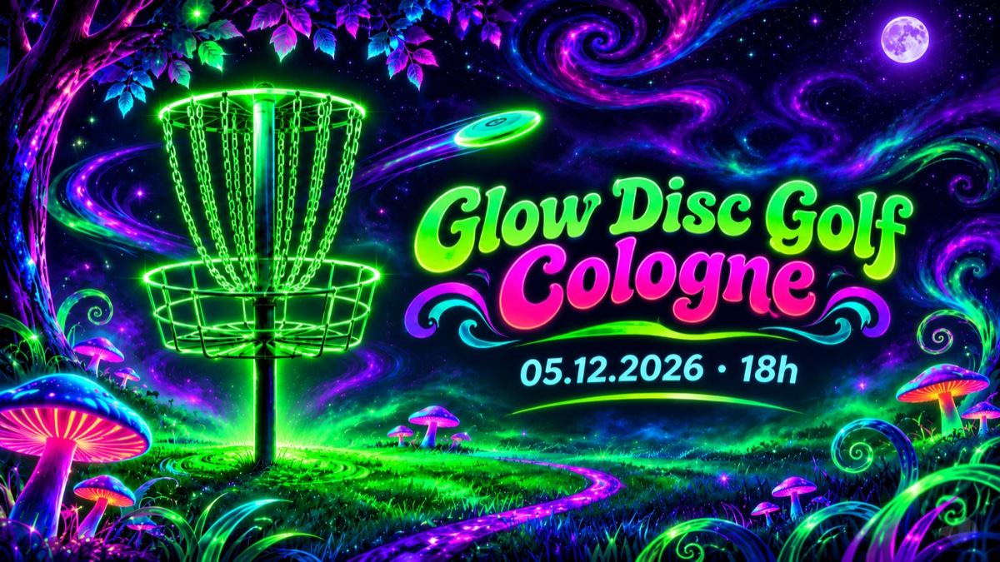

import OnTour from "../components/OnTour.svelte";

## Glow Disc Golf Cologne

Lust auf Disc Golf nach Sonnenuntergang? Beim **Glow Disc Golf Cologne** spielen wir am **Samstag, 5. Dezember 2026, ab 18 Uhr** eine entspannte Runde bei Dunkelheit mit leuchtenden Scheiben. Bring gern deine leuchtenden Scheiben und warme Kleidung mit. Du bist neu dabei? Kein Problem: Das Event ist locker und offen für alle Spielstärken.

Details zu Treffpunkt, Anmeldung und möglichen Änderungen teilen wir vorab in [unserem Discord](https://community.syndikat.golf).

## Syndication Weekly

Unsere wöchentliche Liga. Spieler:innen jedes Niveaus sind willkommen. Eine gewertete Runde, danach freies Spielen bis die Sonne unter geht.

> Jeden Dienstag, 18:30 Uhr, [an der Scheibenstraße](https://goo.gl/maps/yqyVDEoEs8Qd5LD56) – [Event auf UDisc.com](https://udisc.com/leagues/syndication-weekly)

Wenn du einen breiteren Einstieg suchst, findest du auf [Disc Golf in Köln](/disc-golf-koeln/) auch den Überblick zu Kurs, Training und Verein.

## Syndikat On Tour

Hier siehst du, bei welchen aktuellen Turnieren Spieler\*innen des Syndikats dabei sind. Die Liste wird automatisch aus der offiziellen Starterliste aktualisiert.

<OnTour client:load />

## Weitere Events

Schick uns gern eine [Email an birdie@sydikat.golf](mailto:birdie@syndikat.golf) mit einem Hinweis auf ein Event, das hier veröffentlicht werden sollte.
